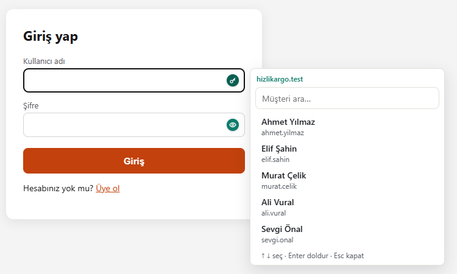
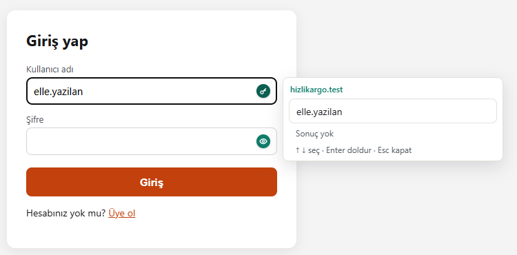
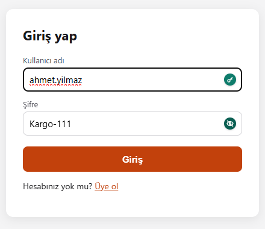
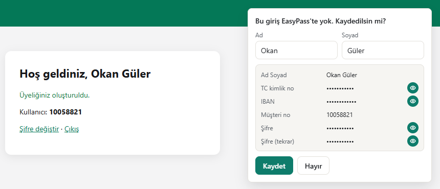
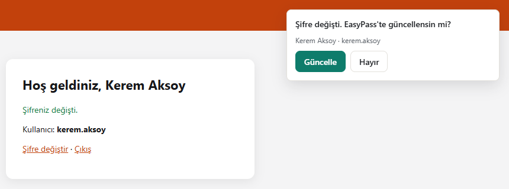
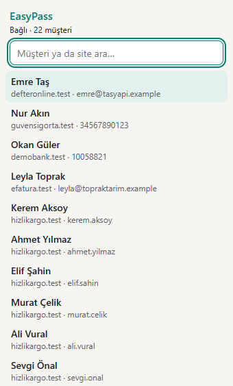
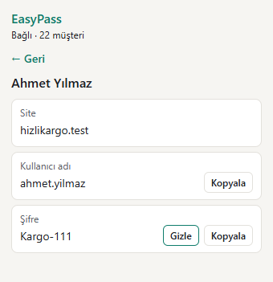
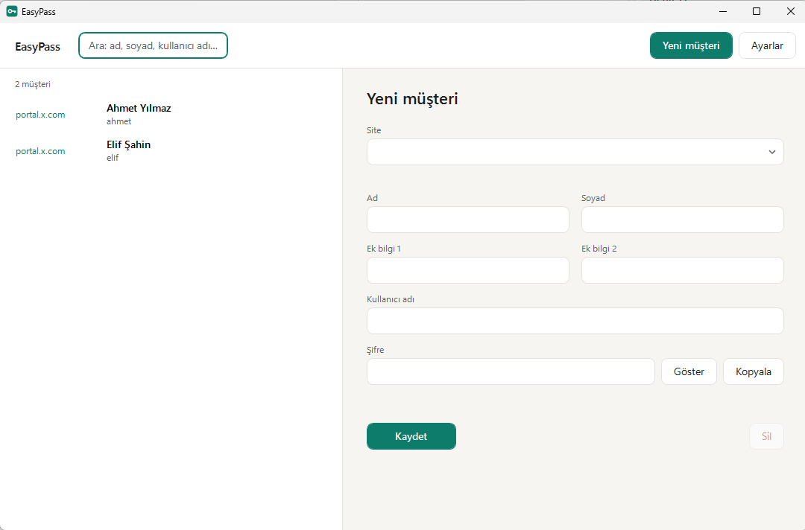

# EasyPass

A lightweight Windows vault for the logins you type for other people — clients, customers, family — with a
Chrome extension that fills them in. Instead of hundreds of entries slowing down Chrome's password manager, the
logins live in one small file; on a login page the extension opens a list next to the username field: type part of
a name, pick the person, and the username and password are filled in milliseconds.

## Features

- **Fill from a list next to the login form.** On a login page the panel opens by itself to the right of the
  username field, showing up to 5 people; typing in the username field narrows the list. Pick with the mouse, or
  with ↓ and Enter.
- **Only that site's logins.** A page only ever sees the entries saved for its own site (or its parent domain).
  The same person on two sites is two entries, each with its own password.
- **Your own typing comes first.** The caret stays in the page's field. Someone who isn't in EasyPass yet is just
  typed by hand; Enter without a selection submits the form as usual.
- **Save and update prompts.** After signing in with a login EasyPass doesn't know, the extension asks
  "Save it?". When a password is changed on a site, it asks to update the saved one.
- **The whole sign-up form is kept.** Signing up on a site, the save prompt takes the first and last name from the
  form and lists everything else that was typed — e-mail, phone, address, ID number… — under the site's own labels.
  Passwords and ID, passport, card and bank numbers stay masked until you press their eye. Saving stores all of it
  in the vault; the app and the toolbar popup show it with the person.
- **Show-password eye** in password fields — unless the site already has its own.
- **Search everything from the toolbar.** The EasyPass button in Chrome's toolbar searches every site's entries by
  name, username or site; a click shows the details, with the password revealed and copied only on request.
- **One file, no master password.** All logins are in a single `vault.ezp` that you can keep in a Google Drive or
  Yandex Disk folder. There is no master password to forget: after reinstalling Windows, install EasyPass and open
  the file. Every save keeps the previous version as `vault.ezp.bak`.
- **Works with the app closed.** Chrome starts EasyPass's small helper program by itself.
- Interface in **Russian** (default) and **Turkish**; Settings → **Язык / Dil**. The extension follows the app.

## Screenshots

| Typing a login that isn't saved yet | Show-password eye |
|---|---|
|  |  |

| After a sign-up: the form's details, ready to save | After a password change: update it? |
|---|---|
|  |  |

| Toolbar search across all sites | Details, password on request |
|---|---|
|  |  |

The EasyPass app, for adding and editing entries by hand:

## Install

1. Download `EasyPass-Setup-<version>.exe` from the [latest release](https://github.com/ishflow/easypass/releases/latest)
   and run it. No administrator rights are needed; to update, install the new version over the old one.
   - If .NET 10 Desktop Runtime is missing, the setup offers to download and install it from Microsoft.
   - It installs the app and the extension to `%LOCALAPPDATA%\EasyPass\`, registers the helper program with Chrome,
     adds a Start menu shortcut and can be removed from Windows **Apps**.
   - The setup isn't code-signed, so Windows may show "Windows protected your PC": **More info → Run anyway**.
2. Add the Chrome extension (once). At the end, the setup opens Chrome's extensions page and the extension folder:
   turn on **Developer mode** (top right) and drag the `extension` folder onto the page. (Or **Load unpacked** →
   `%LOCALAPPDATA%\EasyPass\extension`.)
3. Pin EasyPass in Chrome's toolbar (puzzle icon → pin) and click it: it should show *Bağlı* (Russian: *Подключено*) — connected.

After updating EasyPass, press the reload button (⟳) of EasyPass on `chrome://extensions`, or restart Chrome:
Chrome doesn't pick up new files of an unpacked extension by itself.

> **Why not "Add extension?" from the setup?** On Windows, Chrome only offers to enable extensions that another
> program installs if they come from the Chrome Web Store. Once the extension is published there (unlisted is
> enough), build the setup with its ID — `iscc /DWebStoreId=<id> installer\EasyPass.iss` — and Chrome asks
> "New extension added — enable?" on its next start.

## Using it

The interface is in Turkish and Russian; names of buttons and messages are given in both.

1. Open **EasyPass** from the Start menu and **create a vault** (*Kasayı oluştur* / *Создать*): choose a folder, ideally in Google Drive or
   Yandex Disk. No password is asked.
2. Add people with **New client** (*Yeni müşteri* / *Новый клиент*): site, first and last name, two optional notes, username and password.
   **The site is required** (e.g. `portal.example.com`; paste a full address and only the host is kept).
3. Open a site's login page. The panel opens next to the username field; type part of a name, then click the
   person or press ↓ and Enter. If the panel was closed, click the username field or the green key icon.
4. Signing up or signing in with a new login brings up the save prompt — with the names and the form's other
   details already filled in — and changing a password on the site brings up the update prompt. The app's list
   refreshes within 2 seconds.
5. Use the toolbar button to look up anyone on any site.

### After reinstalling Windows or on a new computer

1. Install Google Drive / Yandex Disk and wait for the vault folder to sync.
2. Install EasyPass and the extension as above.
3. EasyPass → **Open existing vault** (*Var olan kasayı aç* / *Открыть существующее*) → select `vault.ezp` → **Open**
   (*Aç* / *Открыть*). No password needed.

> A vault from EasyPass 1.1 or earlier had a master password. EasyPass asks for it once, removes it and never asks
> again; if the vault was already open on this computer, it is removed without asking.

## Security notes

- **No master password** is a deliberate trade-off: nothing can be lost to a forgotten password, but anyone who
  gets the vault file can read it. Keep it in a folder only you can access, and don't share that cloud folder.
- Web pages only get their own site's entries; listing every site is allowed only from the extension's own toolbar
  popup. Passwords are only filled into `https://` pages (plain http only on `localhost` and `*.localhost`).
- Sign-up details are stored with the person; values that look sensitive by their label (ID, passport, card, bank,
  PIN, password) are masked on screen until asked, and left out of search.
- A password copied from the toolbar popup stays on the clipboard; the app clears its copies after 30 seconds.

## Uninstall

Remove **EasyPass** from Windows **Apps**, then the extension from `chrome://extensions`. Your vault file and the
settings in `%APPDATA%\EasyPass` are kept.

## Troubleshooting

| Symptom | Fix |
|---|---|
| The extension says *Bağlantı yok* / *Нет связи* (no connection) | Run the setup again, then close Chrome completely and reopen it. |
| The extension says *Kilitli* / *Хранилище заблокировано* (locked) | The vault is an old one with a master password: open EasyPass and enter it once (it is then removed). |
| The panel doesn't appear on some sites | Login forms inside frames (iframes) aren't supported yet. |
| The panel says *Güvensiz sayfa (http)* / *Небезопасная страница (http)* | Passwords are only filled into `https://` pages; open the address with `https://`. |
| The vault doesn't open / the file is damaged | `vault.ezp.bak` next to it is the previous version: copy it, name the copy `vault.ezp` and open it. |
| *Kasa dosyası bulunamadı … / Файл хранилища не найден …* (vault file not found, a backup exists) on start | A save was interrupted or the cloud folder hasn't synced yet. Wait and reopen; if the file doesn't come back, open a copy of `vault.ezp.bak` named `vault.ezp`. |

## Development

Three .NET 10 projects and a Manifest V3 extension:

- `src/EasyPass.Core` — vault file (AES-256-GCM, atomic writes, `.bak`), search, site matching, the native messaging
  API shared by the app and the helper.
- `src/EasyPass.Host` — the console helper Chrome starts (native messaging over stdin/stdout).
- `src/EasyPass.App` — the WPF app.
- `extension/` — content script (panel, key and eye icons, save/update prompts), background service worker,
  toolbar popup.
- `installer/EasyPass.iss` — Inno Setup script; `scripts/install.ps1` — an install script for development.

Build and test:

- `dotnet test EasyPass.slnx` (Windows). On macOS/Linux the WPF project builds with
  `-p:EnableWindowsTargeting=true` but can't run; use `dotnet test tests/EasyPass.Tests` there.
- `EASYPASS_HOME` points the settings folder (`settings.json`, `key.bin`) somewhere other than `%APPDATA%\EasyPass`
  (development and CI smoke runs).
- Extension tests (macOS, Playwright, fake helper, Russian + Turkish): `cd extension/test && npm install && npm test`
  (needs `openssl`).
- End-to-end on Windows with EasyPass installed: `cd extension/test && npm install && node e2e-windows.mjs` —
  the installed helper, a separate test vault (`%LOCALAPPDATA%\EasyPass-e2e`) and five local test sites in a
  Chrome for Testing window: login, sign-up → save, password change → update, eye, toolbar popup and site
  isolation. Your own Chrome and vault are untouched. `--headless` runs without a window; `--open` leaves the
  window open afterwards. `EASYPASS_DIR` points at another build instead of the installed one.
- Test sites in your own Chrome: `node extension/test/sites.mjs 8080 --vault <new-file.ezp>` serves five portals at
  `http://hizlikargo.localhost:8080` and so on; `--vault` writes a vault with their users to open in EasyPass.
- Setup locally: with `publish\` ready at the repository root (`dotnet publish` of the app and the helper),
  `iscc installer\EasyPass.iss` → `dist\EasyPass-Setup-<version>.exe`.
- Every push runs GitHub Actions on `windows-latest`: build, tests (including the real helper end to end), a
  start-up smoke test of `EasyPass.exe`, and the setup; artifacts `EasyPass-Setup` and `EasyPass`.
- Design notes (Turkish): `docs/superpowers/specs/2026-10-16-easypass-design.md`.
