

# EasyPass

**Client logins, filled in one click.**

A small Windows vault and a Chrome extension for people who sign in to the same portals for many clients: 
accountants, bookkeepers, agencies and office staff.

[**Download for Windows**](https://github.com/ishflow/easypass/releases/latest) · [How it works](#how-it-works) · [Install](#install) · [Security](#security) · [Development](#development)

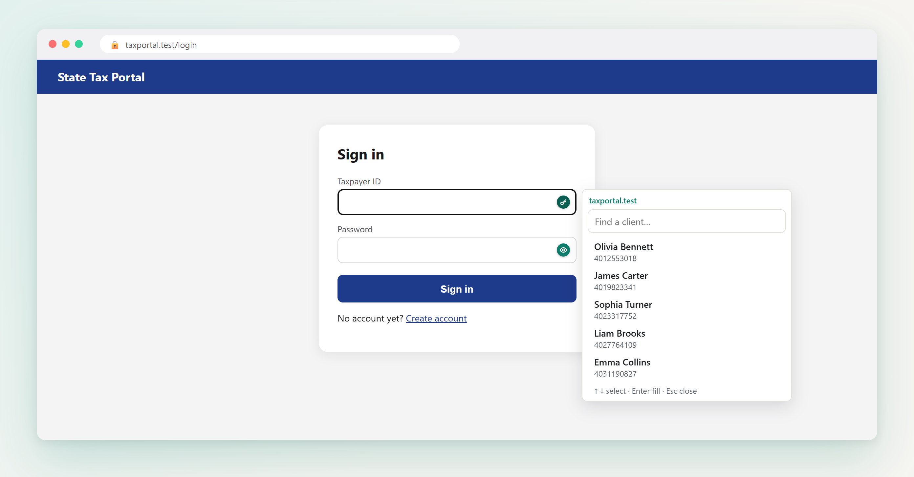

## Why

If you sign in for other people, the same portal holds dozens or hundreds of your logins: one per client. Chrome's
password manager only shows usernames, offers them in a long list, and can get slow on login pages once it holds
thousands of entries.

EasyPass keeps those logins in one small file, **under the client's name**. On a login page a panel opens next to the
username field: type part of a name, press Enter, and the username and password are filled. Signing a client up on a
new site, or changing a password there, is saved back without leaving the page.

## How it works

<table>
<tr>
<td width="50%" valign="top">

**1. The panel opens by itself.** On a login page it appears to the right of the username field with the clients
saved for *this* site, while the caret stays in the field.

</td>
<td width="50%" valign="top">

**2. Type a few letters.** What you type in the username field narrows the list by first name, last name or
username. Pick with ↓ and Enter, or click.

</td>
</tr>
<tr>
<td>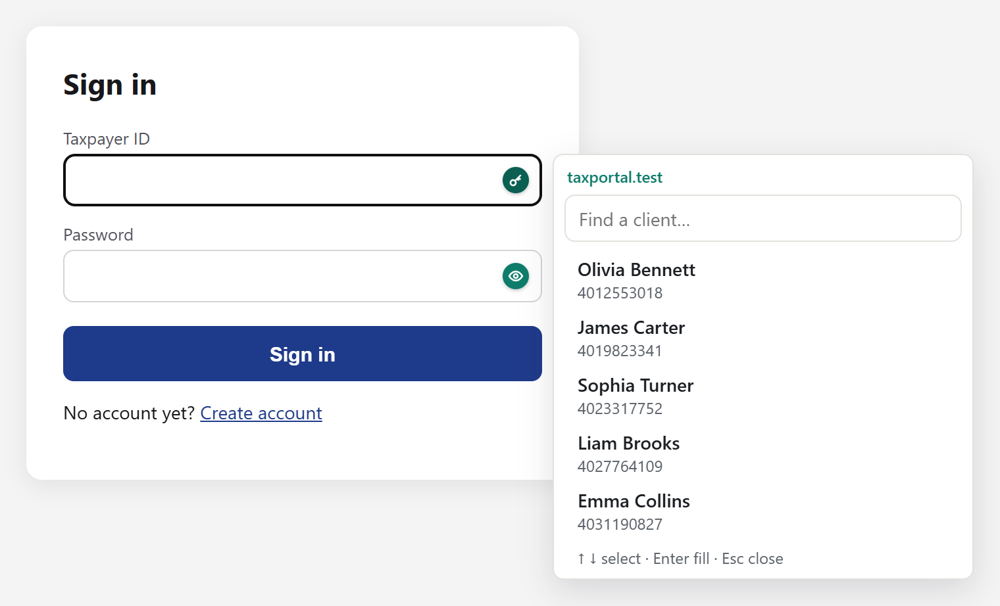</td>
<td>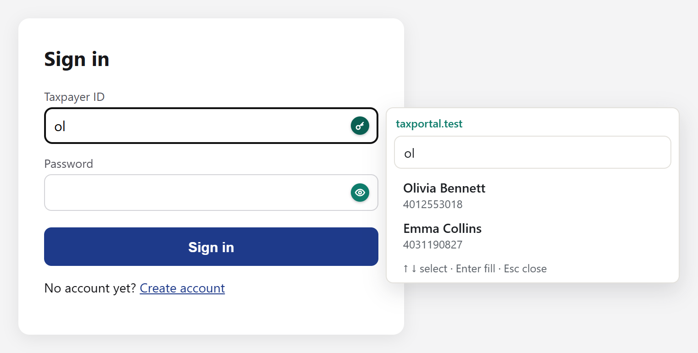</td>
</tr>
<tr>
<td width="50%" valign="top">

**3. Filled.** Username and password are in the form; the eye shows the password if you want to check it. Someone
who isn't saved yet is simply typed by hand, and Enter submits the form as usual.

</td>
<td width="50%" valign="top">

**4. New sign-ups are kept whole.** After signing a client up, EasyPass offers to save the login with the first and
last name filled in, plus everything else the form asked for under the site's own labels. ID and bank numbers and
passwords stay masked until you press their eye.

</td>
</tr>
<tr>
<td>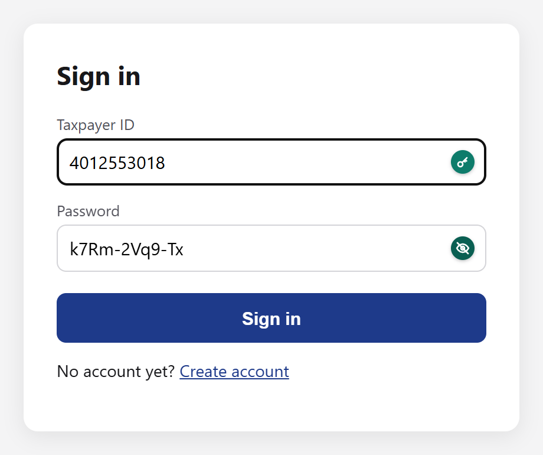</td>
<td>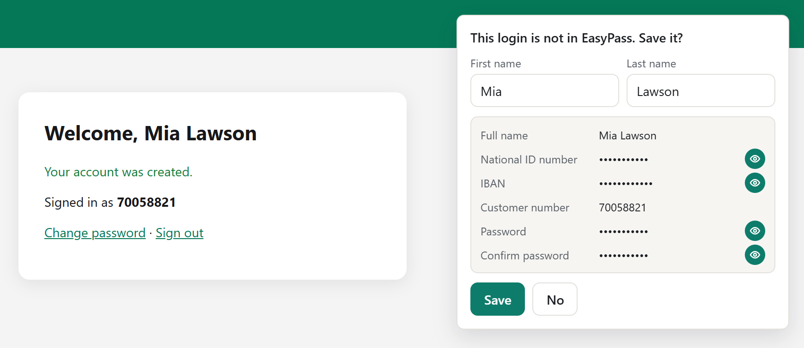</td>
</tr>
<tr>
<td width="50%" valign="top">

**5. Password changes follow.** Change a password on the site after signing in with EasyPass, and it asks to update
the saved one.

</td>
<td width="50%" valign="top">

**6. Search everything from the toolbar.** The EasyPass button in Chrome searches every site's clients; a click
shows the details, with the password revealed and copied only on request.

</td>
</tr>
<tr>
<td>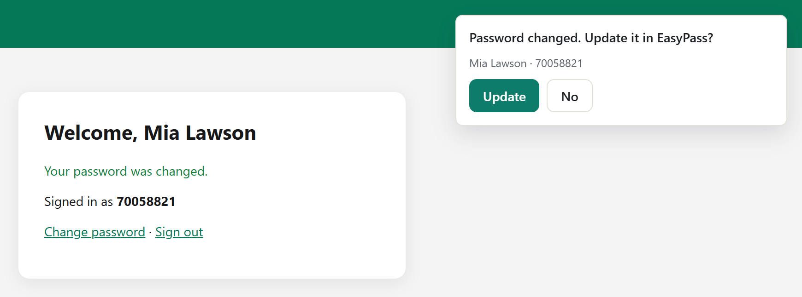</td>
<td>
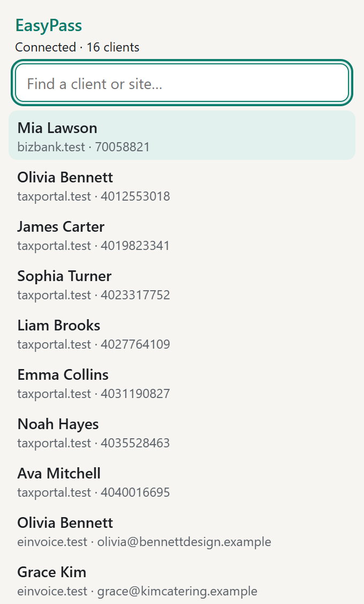
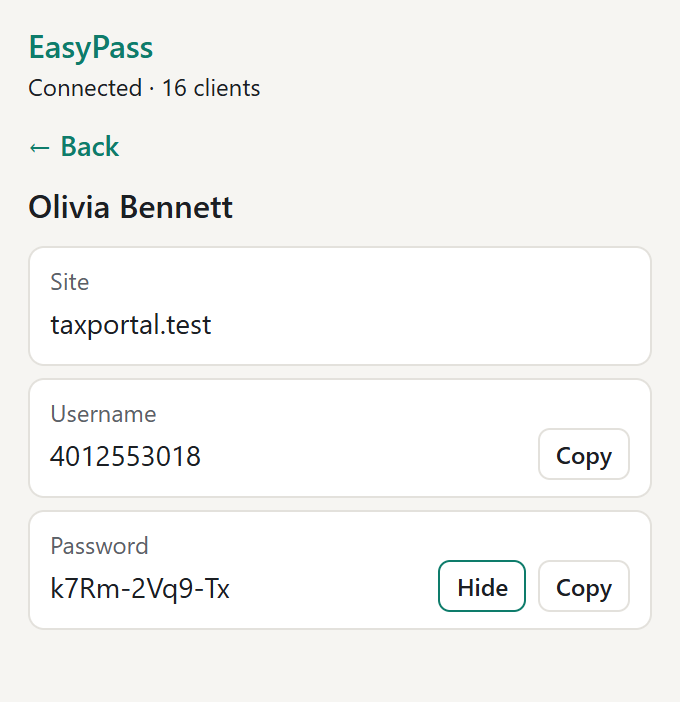
</td>
</tr>
</table>

**The app** is where you add, edit and delete clients by hand, see what a site's sign-up form collected, and switch
the language. The list refreshes within 2 seconds when the extension saves something.

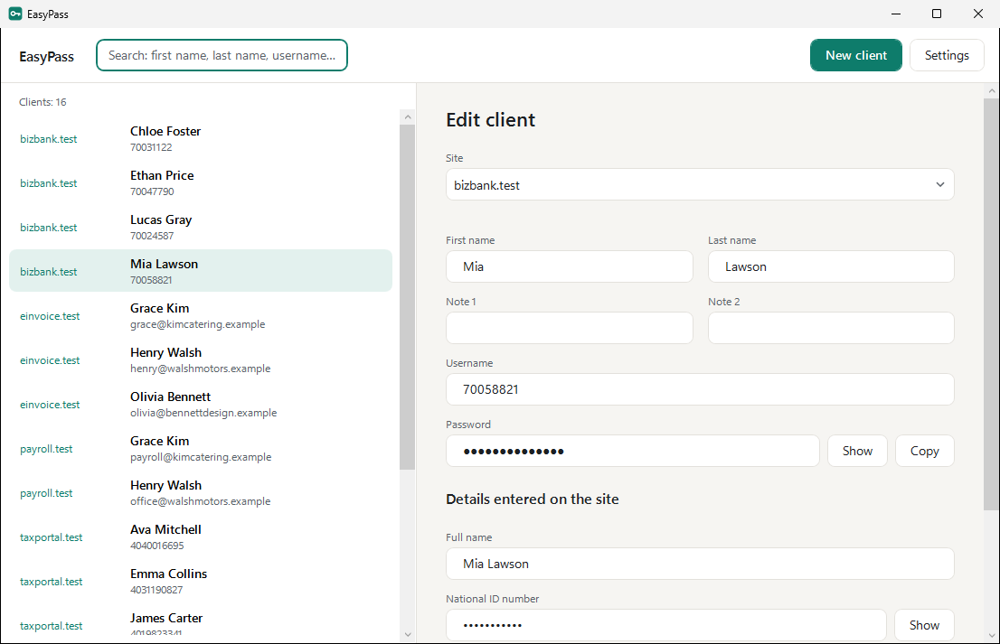
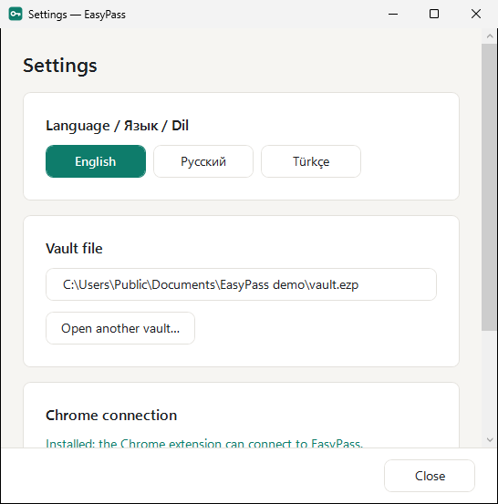

## Monthly work (v1.6)

For offices that do the same jobs for every client every month (a VAT return, payroll, an annual report), EasyPass
keeps a per-client, per-month record in the same vault file, and reminds you of what is left.

- **After you sign out of the tracked portal** (`cabinet.salyk.kg`), a panel opens on the page that follows: mark each
  job of the month *Done* or *Not finished*. For a job that is not finished, pick when to be reminded (in 2 or 5 hours,
  tomorrow, in 2 days, or a number of hours or days). It only opens for a client you signed in as through EasyPass,
  and no other site gets this script.
- **The client's name is read from the portal** the first time you sign in, when the entry has no name yet. A name you
  typed yourself is never overwritten.
- **The app** has three more tabs next to *Clients*: **To do** (this month's list: not started, unfinished, done, with
  month navigation and search), **Notifications** (reminders that are due and planned ones) and **Tasks** (the list of
  jobs, which you add, rename and delete). The *Clients* tab shows a client's earlier months.
- **A reminder pops up in the lower right corner** of the screen with the job, the client's name and login (never the
  password). It stays until you click it, and comes back after a restart if you didn't.
- **The app lives in the tray.** Closing the window hides it; use the tray icon's *Exit* to quit. It can start with
  Windows (`EasyPass.exe --background` starts it hidden) so reminders arrive without opening anything, and a second
  launch just brings the window forward. `EasyPass.exe --quit` ends a running copy (the setup uses it).

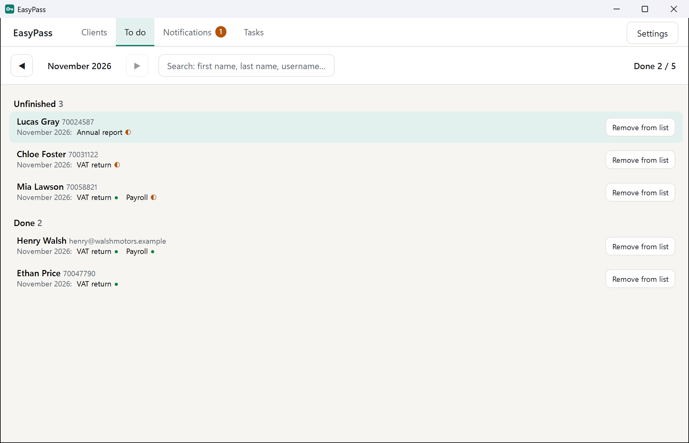
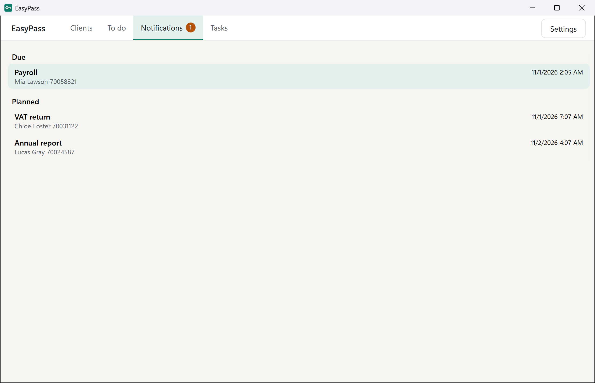

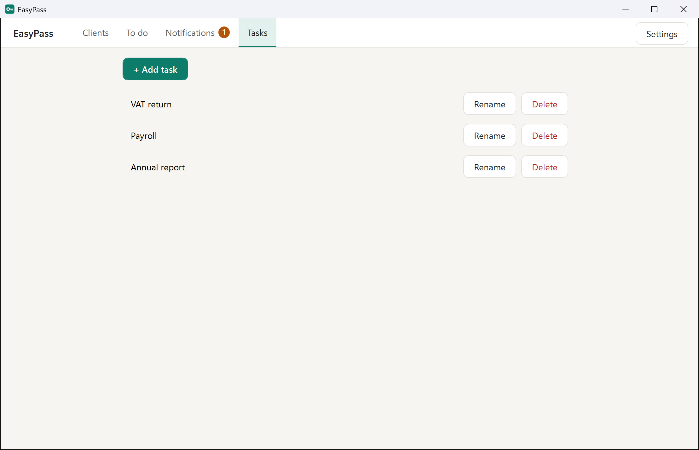
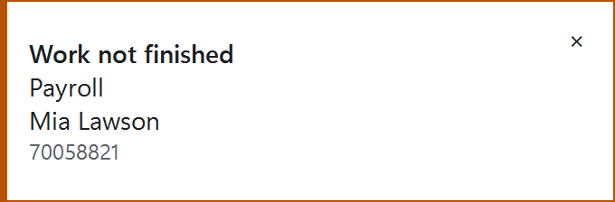

The same tabs and texts are in Russian and Turkish (`docs/images/i18n/`).

> **Update every computer together.** Version 1.6 adds jobs, work records and reminders to the vault file. EasyPass
> 1.5 doesn't know these fields: if 1.5 opens the vault (for example on another computer that shares the file through
> a cloud folder) and saves anything, **it silently deletes them**. The first work you record in 1.6 is the moment
> after which this matters; update all your computers before then. `vault.ezp.bak` keeps the previous version of the file.

## Features

- **Only that site's logins.** A page only ever sees the entries saved for its own site (or its parent domain). The
  same person on two sites is two entries, each with its own password.
- **Your typing comes first.** The panel never takes the caret; Enter without a selection submits the form as typed.
- **One file, no master password.** All logins are in a single `vault.ezp` you can keep in a Google Drive or Yandex
  Disk folder. After reinstalling Windows, install EasyPass and open the file. Every save keeps the previous version
  as `vault.ezp.bak`.
- **Works with the app closed.** Chrome starts EasyPass's small helper program by itself.
- **Starts with Windows, lives in the tray**, and shows reminders for unfinished monthly work (see above).
- **Show-password eye** in password fields, unless the site already has its own.
- **Number-only logins** (tax IDs and customer numbers in `type="number"` fields) work like any other.
- **English, Russian and Turkish.** Settings → *Language / Язык / Dil*; the extension follows the app. A first install
  starts in the setup's language.

## Install

1. Download **`EasyPass-Setup-<version>.exe`** from the [latest release](https://github.com/ishflow/easypass/releases/latest)
   and run it. No administrator rights are needed; to update, install the new version over the old one.
   - If the .NET 10 Desktop Runtime is missing, the setup offers to download and install it from Microsoft.
   - It installs the app and the extension to `%LOCALAPPDATA%\EasyPass\`, registers the helper program with Chrome,
     adds a Start menu shortcut, and can be removed from Windows **Apps**.
   - The setup isn't code-signed, so Windows may show "Windows protected your PC": **More info → Run anyway**.
2. **Add the Chrome extension** (once). At the end, the setup opens Chrome's extensions page and the extension folder:
   turn on **Developer mode** (top right) and drag the `extension` folder onto the page. (Or **Load unpacked** →
   `%LOCALAPPDATA%\EasyPass\extension`.)
3. Pin EasyPass in Chrome's toolbar (puzzle icon → pin) and click it: it should say **Connected**.

After updating EasyPass, press the reload button (⟳) of EasyPass on `chrome://extensions`, or restart Chrome: Chrome
doesn't pick up new files of an unpacked extension by itself.

> **Why not "Add extension?" from the setup?** On Windows, Chrome only offers to enable extensions that another
> program installs if they come from the Chrome Web Store. Once the extension is published there (unlisted is
> enough), build the setup with its ID — `iscc /DWebStoreId=<id> installer\EasyPass.iss` — and Chrome asks
> "New extension added — enable?" on its next start.

## Using it

1. Open **EasyPass** from the Start menu and **Create vault**: choose a folder, ideally in Google Drive or Yandex Disk.
   No password is asked.
2. Add clients with **New client**: site, first and last name, two optional notes, username and password.
   **The site is required** (e.g. `portal.example.com`; paste a full address and only the host is kept).
3. Open a site's login page. The panel opens next to the username field; type part of a name, then click the client
   or press ↓ and Enter. If you closed the panel, click the username field or the green key icon.
4. Signing up or signing in with a new login brings up the save prompt; changing a password on the site brings up
   the update prompt.
5. Use the toolbar button to look up anyone on any site.

**After reinstalling Windows or on a new computer:** let Google Drive / Yandex Disk sync the vault folder, install
EasyPass and the extension as above, then **Open an existing vault** → `vault.ezp` → **Open**. No password needed.

> A vault from EasyPass 1.1 or earlier has a master password. EasyPass asks for it once, removes it and never asks
> again; if the vault was already open on this computer, it is removed without asking.

## Security

- **No master password is a deliberate trade-off:** nothing can be lost to a forgotten password, but anyone who gets
  the vault file can read it. The file is AES-256-GCM, yet without a master password its key comes from the file
  itself, so treat it like a password list: keep it in a folder only you can access and don't share that cloud folder.
- Web pages only get their own site's entries. Listing every site is allowed only from the extension's own toolbar
  popup, and the extension talks to the helper only through Chrome native messaging (no local port).
- Passwords are only filled into `https://` pages (plain http only on `localhost` and `*.localhost`).
- Sign-up details are stored with the client. Values that look sensitive by their label (ID, passport, card, bank,
  PIN, password) are masked on screen until asked, and left out of search.
- The app clears a password it copied from the clipboard after 30 seconds and keeps it out of clipboard history; a
  password copied from the toolbar popup stays on the clipboard.
- EasyPass has no telemetry and makes no network requests of its own; the setup downloads the .NET runtime from
  Microsoft only if it is missing and you agree.

## Troubleshooting

| Symptom | Fix |
|---|---|
| The extension says *Not connected* | Run the setup again, then close Chrome completely and reopen it. |
| The extension says *Vault locked* | The vault is an old one with a master password: open EasyPass and enter it once (it is then removed). |
| The panel doesn't appear on some sites | Login forms inside frames (iframes) aren't supported yet. |
| The panel says *Insecure page (http)* | Passwords are only filled into `https://` pages; open the address with `https://`. |
| The vault doesn't open / the file is damaged | `vault.ezp.bak` next to it is the previous version: copy it, name the copy `vault.ezp` and open it. |
| *Vault file not found … (a backup exists)* on start | A save was interrupted or the cloud folder hasn't synced yet. Wait and reopen; if the file doesn't come back, open a copy of `vault.ezp.bak` named `vault.ezp`. |

## Uninstall

Remove **EasyPass** from Windows **Apps**, then the extension from `chrome://extensions`. Your vault file and the
settings in `%APPDATA%\EasyPass` are kept.

## Development

Three .NET 10 projects and a Manifest V3 extension:

| Path | What |
|---|---|
| `src/EasyPass.Core` | Vault file (AES-256-GCM, atomic writes, `.bak`), search, site matching, the native messaging API shared by the app and the helper |
| `src/EasyPass.Host` | The console helper Chrome starts (native messaging over stdin/stdout) |
| `src/EasyPass.App` | The WPF app; texts in `Strings.<en\|ru\|tr>.xaml` |
| `extension/` | Content script (panel, key and eye icons, save/update prompts), background service worker, toolbar popup |
| `installer/EasyPass.iss` | Inno Setup script; `scripts/install.ps1` is an install script for development |

Build and test:

- `dotnet test EasyPass.slnx` (Windows). On macOS/Linux the WPF project builds with `-p:EnableWindowsTargeting=true`
  but can't run; use `dotnet test tests/EasyPass.Tests` there.
- `EASYPASS_HOME` points the settings folder (`settings.json`, `key.bin`) somewhere other than `%APPDATA%\EasyPass`
  (development and CI smoke runs).
- Extension tests (macOS, Playwright, fake helper, English + Russian + Turkish): `cd extension/test && npm install && npm test`
  (needs `openssl`).
- End-to-end on Windows with EasyPass installed: `cd extension/test && npm install && node e2e-windows.mjs` — the
  installed helper, a separate test vault (`%LOCALAPPDATA%\EasyPass-e2e`) and six local test portals in a Chrome for
  Testing window: login, sign-up → save, password change → update, eye, toolbar popup and site isolation. Your own
  Chrome and vault are untouched. `--headless` runs without a window; `--open` leaves the window open afterwards.
  `EASYPASS_DIR` points at another build instead of the installed one.
- README screenshots: `node extension/test/screenshots.mjs` drives the English demo portals (`demo-sites.mjs`) with a
  demo vault and writes `docs/images/` (the app window through `app-shots.ps1`).
- Test sites in your own Chrome: `node extension/test/sites.mjs 8080 --vault <new-file.ezp>` serves the portals at
  `http://hizlikargo.localhost:8080` and so on; `--vault` writes a vault with their users to open in EasyPass.
- Setup locally: with `publish\` ready at the repository root (`dotnet publish` of the app and the helper),
  `iscc installer\EasyPass.iss` → `dist\EasyPass-Setup-<version>.exe`.
- Every push runs GitHub Actions on `windows-latest`: build, tests (including the real helper end to end), a start-up
  smoke test of `EasyPass.exe`, and the setup; artifacts `EasyPass-Setup` and `EasyPass`.
- Design notes (Turkish): `docs/superpowers/specs/2026-10-16-easypass-design.md`.

Made by <a href="https://ishflow.com/ai/projects/easypass">ishflow</a>

